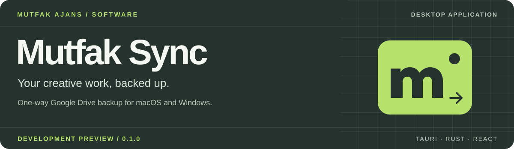
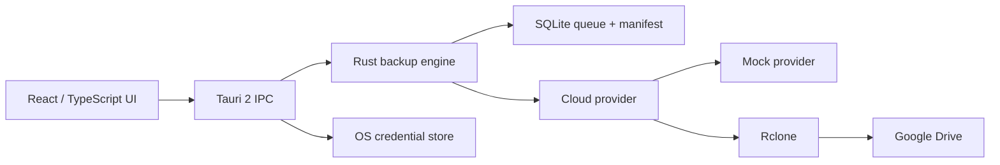

<p align="center">
  
</p>

<p align="center">
  <a href="https://github.com/burakyurday/mutfak-sync/actions/workflows/build.yml"></a>
  
  
  <a href="LICENSE"></a>
</p>

<p align="center">
  <a href="#overview">Overview</a> · <a href="#preview">Preview</a> · <a href="#getting-started">Getting started</a> · <a href="#architecture">Architecture</a> · <a href="docs/USER_GUIDE.md">Türkçe kılavuz</a>
</p>

## Overview

**Mutfak Sync is a one-way desktop backup application for creative teams.** Built for Mutfak Ajans, it preserves local project folders in Google Drive, keeps each workstation in its own destination, and protects cloud copies from local deletion.

> **Development preview (v0.1.0).** The core and UI have automated test coverage; macOS ARM64 and Windows x64 installer builds have passed CI. Real Google OAuth and native platform acceptance tests are not complete. Do not rely on this version as the sole copy of important files.

| Capability | What it does |
| :--- | :--- |
| **Automatic backup** | Monitors a local working folder and queues stable files for upload. |
| **Folder integrity** | Preserves nested folders, empty folders and Unicode names. |
| **One-way protection** | Local deletion does not delete the cloud copy. |
| **Persistent queue** | SQLite-backed manifest, retries and recovery across restarts. |
| **Controlled archiving** | Explicit confirmation, verification and OS trash integration; native acceptance tests pending. |
| **Cross-platform desktop** | Tauri interface, Rust engine and bundled Rclone for macOS/Windows. |

## Preview

<!-- preview:start -->
The React browser preview is generated by the [UI preview workflow](https://github.com/burakyurday/mutfak-sync/actions/workflows/preview.yml). It is not a native desktop screenshot or a live Google Drive connection.
<!-- preview:end -->

## Getting started

### Download a development build

Open the [latest successful packaging workflow](https://github.com/burakyurday/mutfak-sync/actions/runs/43187922980) and locate the platform artifact in **Artifacts**. GitHub login may be required; artifacts expire after 14 days.

| Platform | Artifact | Package |
| :--- | :--- | :--- |
| macOS Apple Silicon | `mutfak-sync-aarch64-apple-darwin-unsigned` | .app / .dmg |
| Windows x64 | `mutfak-sync-x86_64-pc-windows-msvc-unsigned` | .exe / .msi |

These are unsigned development artifacts, not a production release. Do not disable operating-system security protections. Use a separate test folder and the mock provider first. See [validation and distribution limitations](docs/VALIDATION.md).

### Build locally

Requires Node.js 24, Rust toolchain from `rust-toolchain.toml` and native build tools. Platform prerequisites and detailed setup are in the [Turkish guide](docs/USER_GUIDE.md).

```sh
git clone https://github.com/burakyurday/mutfak-sync.git
cd mutfak-sync
npm ci
npm run sidecar
npm run desktop
```

For a web-only UI preview, run `npm run dev`. The browser preview does not perform real file operations or backups.

## Architecture



The Rust engine controls filesystem operations, upload verification and recovery. The UI does not receive shell or direct filesystem permissions. Google OAuth credentials are handled through the operating-system credential store; the Drive OAuth scope is broader than the selected folder.

## Technology

`Tauri 2` · `Rust` · `React 19` · `TypeScript` · `Vite` · `SQLite` · `Rclone` · `Vitest` · `Playwright`

## Development & quality

```sh
npm test
npm run build
cargo test --manifest-path src-tauri/Cargo.toml --locked
npm run test:e2e
```

The existing CI matrix runs tests and produces unsigned desktop packages on macOS and Windows. See [test evidence and known limits](docs/VALIDATION.md) rather than treating a green build as proof of production readiness.

## Documentation

| Document | Contents |
| :--- | :--- |
| [User guide (TR)](docs/USER_GUIDE.md) | Setup, daily use, storage and platform requirements |
| [Architecture](docs/ARCHITECTURE.md) | Engine, persistence, security and race-condition boundaries |
| [Validation](docs/VALIDATION.md) | Tests, evidence and outstanding acceptance checks |
| [Operations](docs/OPERATIONS.md) | Troubleshooting and operational guidance |
| [Changelog](CHANGELOG.md) | Version history and release status |
| [Roadmap](docs/ROADMAP.md) | Release gates and future work |
| [Security](SECURITY.md) | Vulnerability reporting and safe handling of credentials |
| [Contributing](CONTRIBUTING.md) | Local development and contribution guidelines |

## License

MIT · [Mutfak Ajans](LICENSE). Rclone's separate upstream license is preserved in [docs/licenses](docs/licenses).

---

<p align="center"><sub>DESIGNED & DEVELOPED FOR MUTFAK AJANS · BUILT FOR CREATIVE WORKFLOWS</sub></p>
